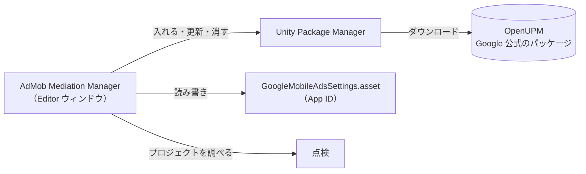

<h1 align="center">AdMob Mediation Manager for Unity</h1>

<p align="center">
  <b>LevelPlay の Integration Manager のように、AdMob のメディエーションを Unity の中で管理するツール。</b><br>
  アダプタの導入・更新、App ID の設定、組み込みの点検を 1 つのウィンドウで。
</p>

<p align="center">
  <a href="https://unity.com/"></a>
  <a href="#動作環境"></a>
  <a href="https://github.com/haru-sudo/unity-admob-mediation-manager/blob/main/package.json"></a>
  <a href="LICENSE"></a>
  <br>
  <a href="#対応ネットワーク"></a>
  <a href="https://github.com/haru-sudo/unity-admob-mediation-manager/commits/main"></a>
</p>

<p align="center">
  <a href="README.md">English</a> · <b>日本語</b>
</p>

> [!NOTE]
> 非公式のコミュニティ製ツールです。Google・Unity とは関係がなく、承認やサポートも受けていません。
> Google のコードは含まず、公式の Google のパッケージを Unity Package Manager 経由で操作します。

<a id="目次"></a>

## 目次

- [できること](#できること)
- [動作環境](#動作環境)
- [導入](#導入)
- [使い方](#使い方)
- [Ad Unit ID Set](#ad-unit-id-set)
- [仕組み](#仕組み)
- [対応ネットワーク](#対応ネットワーク)
- [プライバシー](#プライバシー)
- [ライセンス](#ライセンス)

<a id="できること"></a>

## できること

<table>
  <tr>
    <th width="33%">Networks</th>
    <th width="33%">App Settings</th>
    <th width="33%">Integration Status</th>
  </tr>
  <tr valign="top">
    <td>
      <ul>
        <li>Google Mobile Ads・EDM4U・<b>18 のアダプタ</b>を一覧表示</li>
        <li>入っている版と最新版がひと目でわかる</li>
        <li><b>Install / Update / Update all / Remove</b> をワンクリック</li>
        <li>アダプタごとの Android・iOS の SDK の版を表示</li>
        <li><code>.unitypackage</code> で入れたものを見つけて<b>移行</b>、二重導入を警告</li>
      </ul>
    </td>
    <td>
      <ul>
        <li>Android・iOS の <b>App ID</b> を形のチェックつきで編集</li>
        <li>iOS の ATT の説明文を編集</li>
        <li>Google のサンプル App ID をワンクリックで</li>
        <li>テスト広告に一括で切り替えられる <b>Ad Unit ID Set</b></li>
      </ul>
    </td>
    <td>
      <ul>
        <li>広告が出ない原因になりやすい問題を点検</li>
        <li>多くの項目に<b>直すボタン</b>つき</li>
        <li>不具合報告用の <b>Copy report</b>（ID は含めません）</li>
      </ul>
    </td>
  </tr>
</table>

<a id="動作環境"></a>

## 動作環境

| | |
| --- | --- |
| **Unity** | 2021.3 以降 |
| **プラットフォーム** | Android または iOS のビルドサポート |
| **ネット接続** | 導入・更新の確認のときに必要 |

<a id="導入"></a>

## 導入

**Window › Package Manager** の **＋ › Add package from git URL…** に次を入力します。

```
https://github.com/haru-sudo/unity-admob-mediation-manager.git
```

> [!TIP]
> 版を固定するときは末尾にタグを付けます：`https://github.com/haru-sudo/unity-admob-mediation-manager.git#v1.0.0`

<a id="使い方"></a>

## 使い方

**Tools › AdMob Mediation Manager** を開きます。

| 手順 | 場所 | すること |
| :---: | --- | --- |
| **1** | **Networks** | **Google Mobile Ads** を入れる。EDM4U はふつう一緒に入ります（*Not installed* のままなら EDM4U も入れる） |
| **2** | **Networks** | 使うネットワークのアダプタを入れる。最初の 1 回だけ OpenUPM を足してよいか確認が出ます |
| **3** | **App Settings** | AdMob の管理画面（*アプリ › アプリの設定*）の App ID を貼って **Save** |
| **4** | **Integration Status** | 赤い項目をビルド前に直す |
| **5** | [AdMob の管理画面](https://apps.admob.com/) | 各ネットワークを**メディエーショングループ**に追加し、各社の手順（行の **Docs**）に沿って設定 |
| **6** | ゲーム | 登録済みのテスト端末で広告インスペクタ（`MobileAds.OpenAdInspector`）を開き、配信を確認 |

> [!IMPORTANT]
> アダプタを入れるだけでは配信されません。ウォーターフォールや入札の設定は AdMob の管理画面で行います。

<a id="ad-unit-id-set"></a>

## Ad Unit ID Set

広告ユニット ID を 1 つのアセットにまとめ、スイッチ 1 つでテスト広告に切り替えられます。
**App Settings › Ad unit IDs › Create…** か **Assets › Create › AdMob Mediation Manager › Ad Unit ID Set** で作り、
コードからは `adUnits.Get(AdFormat.Rewarded)` のように読みます（例は [English README](README.md#ad-unit-id-set)）。

> [!WARNING]
> リリースのビルドでは **Use Test Ad Units** をオフにしてください。テスト広告は収益になりません。

<a id="仕組み"></a>

## 仕組み



Google は AdMob 本体と各アダプタを [OpenUPM](https://openupm.com/packages/?q=com.google.ads.mobile) で公開しています。
版は毎回レジストリに問い合わせるので、ツールに版は書き込んでいません。プロジェクトを変えるのはボタンを押したときだけです。

| 操作 | 変わるファイル |
| --- | --- |
| 最初の導入 | `Packages/manifest.json` に OpenUPM のレジストリを追加（確認ダイアログのあと。既存の内容と順番はそのまま） |
| 導入・更新・削除 | Unity Package Manager 経由で `Packages/manifest.json` と `Packages/packages-lock.json` |
| `.unitypackage` のアダプタの削除・移行 | `Assets/GoogleMobileAds/Mediation/<ネットワーク>` をゴミ箱へ（元に戻せます） |
| App ID の保存 | AdMob 本体の設定 `Assets/GoogleMobileAds/Resources/GoogleMobileAdsSettings.asset`（Undo できます） |

<a id="対応ネットワーク"></a>

## 対応ネットワーク

| ネットワーク | パッケージ | OpenUPM の最新版 | 手順 |
| --- | --- | :---: | :---: |
| **AppLovin** | `com.google.ads.mobile.mediation.applovin` | [](https://openupm.com/packages/com.google.ads.mobile.mediation.applovin/) | [Docs](https://developers.google.com/admob/unity/mediation/applovin) |
| **BidMachine** | `com.google.ads.mobile.mediation.bidmachine` | [](https://openupm.com/packages/com.google.ads.mobile.mediation.bidmachine/) | [Docs](https://developers.google.com/admob/unity/mediation) |
| **Chartboost** | `com.google.ads.mobile.mediation.chartboost` | [](https://openupm.com/packages/com.google.ads.mobile.mediation.chartboost/) | [Docs](https://developers.google.com/admob/unity/mediation/chartboost) |
| **DT Exchange** | `com.google.ads.mobile.mediation.dtexchange` | [](https://openupm.com/packages/com.google.ads.mobile.mediation.dtexchange/) | [Docs](https://developers.google.com/admob/unity/mediation/dt-exchange) |
| **i-mobile** | `com.google.ads.mobile.mediation.imobile` | [](https://openupm.com/packages/com.google.ads.mobile.mediation.imobile/) | [Docs](https://developers.google.com/admob/unity/mediation/i-mobile) |
| **InMobi** | `com.google.ads.mobile.mediation.inmobi` | [](https://openupm.com/packages/com.google.ads.mobile.mediation.inmobi/) | [Docs](https://developers.google.com/admob/unity/mediation/inmobi) |
| **ironSource** | `com.google.ads.mobile.mediation.ironsource` | [](https://openupm.com/packages/com.google.ads.mobile.mediation.ironsource/) | [Docs](https://developers.google.com/admob/unity/mediation/ironsource) |
| **Liftoff Monetize** | `com.google.ads.mobile.mediation.liftoffmonetize` | [](https://openupm.com/packages/com.google.ads.mobile.mediation.liftoffmonetize/) | [Docs](https://developers.google.com/admob/unity/mediation/liftoff-monetize) |
| **LINE Ads Network** | `com.google.ads.mobile.mediation.line` | [](https://openupm.com/packages/com.google.ads.mobile.mediation.line/) | [Docs](https://developers.google.com/admob/unity/mediation/line) |
| **maio** | `com.google.ads.mobile.mediation.maio` | [](https://openupm.com/packages/com.google.ads.mobile.mediation.maio/) | [Docs](https://developers.google.com/admob/unity/mediation/maio) |
| **Meta Audience Network** | `com.google.ads.mobile.mediation.metaaudiencenetwork` | [](https://openupm.com/packages/com.google.ads.mobile.mediation.metaaudiencenetwork/) | [Docs](https://developers.google.com/admob/unity/mediation/meta) |
| **Mintegral** | `com.google.ads.mobile.mediation.mintegral` | [](https://openupm.com/packages/com.google.ads.mobile.mediation.mintegral/) | [Docs](https://developers.google.com/admob/unity/mediation/mintegral) |
| **Moloco** | `com.google.ads.mobile.mediation.moloco` | [](https://openupm.com/packages/com.google.ads.mobile.mediation.moloco/) | [Docs](https://developers.google.com/admob/unity/mediation/moloco) |
| **myTarget** | `com.google.ads.mobile.mediation.mytarget` | [](https://openupm.com/packages/com.google.ads.mobile.mediation.mytarget/) | [Docs](https://developers.google.com/admob/unity/mediation/mytarget) |
| **Pangle** | `com.google.ads.mobile.mediation.pangle` | [](https://openupm.com/packages/com.google.ads.mobile.mediation.pangle/) | [Docs](https://developers.google.com/admob/unity/mediation/pangle) |
| **PubMatic** | `com.google.ads.mobile.mediation.pubmatic` | [](https://openupm.com/packages/com.google.ads.mobile.mediation.pubmatic/) | [Docs](https://developers.google.com/admob/unity/mediation) |
| **Unity Ads** | `com.google.ads.mobile.mediation.unity` | [](https://openupm.com/packages/com.google.ads.mobile.mediation.unity/) | [Docs](https://developers.google.com/admob/unity/mediation/unity) |
| **Verve** | `com.google.ads.mobile.mediation.verve` | [](https://openupm.com/packages/com.google.ads.mobile.mediation.verve/) | [Docs](https://developers.google.com/admob/unity/mediation) |

一覧は [`Editor/Core/AdapterCatalog.cs`](Editor/Core/AdapterCatalog.cs) にあり、1 行足せばネットワークを追加できます。

<a id="プライバシー"></a>

## プライバシー

- Google 公式のサンプル ID（[`Runtime/GoogleTestIds.cs`](Runtime/GoogleTestIds.cs)）のほか、API キー・App ID・広告ユニット ID は含みません
- どこにも何も送りません。通信は Unity Package Manager が manifest にあるレジストリと行うものだけです
- App ID は AdMob 本体の設定アセットに、広告ユニット ID は自分で作る Ad Unit ID Set に保存されます。
  リポジトリを公開している場合は、そのアセットをバージョン管理から外すことも検討してください

困ったときの対処とコードの構成は [English README](README.md#troubleshooting) を見てください。

<a id="ライセンス"></a>

## ライセンス

[MIT License](LICENSE) で公開しています。© 2026 HAL-JP

<sub>「Google」「AdMob」「Google Mobile Ads」は Google LLC の商標、「LevelPlay」は Unity Technologies の商標です。そのほかのネットワーク名は各社の商標で、互換性の説明のためにだけ使っています。</sub>
