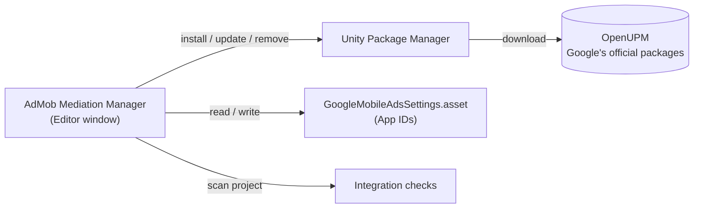

<h1 align="center">AdMob Mediation Manager for Unity</h1>

<p align="center">
  <b>A LevelPlay-style Integration Manager for Google AdMob mediation, right inside the Unity Editor.</b><br>
  Install and update mediation adapters, set your App IDs and catch integration mistakes, all in one window.
</p>

<p align="center">
  <a href="https://unity.com/"></a>
  <a href="#requirements"></a>
  <a href="https://github.com/haru-sudo/unity-admob-mediation-manager/blob/main/package.json"></a>
  <a href="LICENSE"></a>
  <br>
  <a href="#supported-networks"></a>
  <a href="https://github.com/haru-sudo/unity-admob-mediation-manager/commits/main"></a>
</p>

<p align="center">
  <b>English</b> · <a href="README.ja.md">日本語</a>
</p>

> [!NOTE]
> This is an unofficial community project. It is not made, endorsed or supported by Google or Unity.
> It contains no Google code; it drives Google's official packages through the Unity Package Manager.

<a id="contents"></a>

## Contents

- [Features](#features)
- [Requirements](#requirements)
- [Installation](#installation)
- [Quick start](#quick-start)
- [Ad Unit ID Set](#ad-unit-id-set)
- [How it works](#how-it-works)
- [Supported networks](#supported-networks)
- [Privacy](#privacy)
- [Troubleshooting](#troubleshooting)
- [Contributing](#contributing)
- [License](#license)

<a id="features"></a>

## Features

<table>
  <tr>
    <th width="33%">Networks</th>
    <th width="33%">App Settings</th>
    <th width="33%">Integration Status</th>
  </tr>
  <tr valign="top">
    <td>
      <ul>
        <li>Google Mobile Ads, EDM4U and <b>18 adapters</b> in one list</li>
        <li>Installed vs. latest version at a glance</li>
        <li>One-click <b>Install</b>, <b>Update</b>, <b>Update all</b>, <b>Remove</b></li>
        <li>Native Android / iOS SDK versions per adapter</li>
        <li>Finds <code>.unitypackage</code> installs, <b>migrates</b> them and flags duplicates</li>
      </ul>
    </td>
    <td>
      <ul>
        <li>Edit Android / iOS <b>App IDs</b> with format checks</li>
        <li>Edit the iOS ATT prompt text</li>
        <li>Google's sample App IDs in one click</li>
        <li><b>Ad Unit ID Set</b> asset with a single test-ads switch</li>
      </ul>
    </td>
    <td>
      <ul>
        <li>Checks for the mistakes that stop ads from showing</li>
        <li><b>Fix</b> buttons for most findings</li>
        <li><b>Copy report</b> for bug reports (IDs are never included)</li>
      </ul>
    </td>
  </tr>
</table>

<a id="requirements"></a>

## Requirements

| | |
| --- | --- |
| **Unity** | 2021.3 or newer |
| **Platforms** | Android and/or iOS build support |
| **Network** | Needed when installing or checking for updates |

<a id="installation"></a>

## Installation

### Option A: Git URL (recommended)

1. Open **Window › Package Manager**.
2. Click **＋ › Add package from git URL…**
3. Paste:

   ```
   https://github.com/haru-sudo/unity-admob-mediation-manager.git
   ```

> [!TIP]
> To pin a version, append a tag: `https://github.com/haru-sudo/unity-admob-mediation-manager.git#v1.0.0`

### Option B: `Packages/manifest.json`

```json
{
  "dependencies": {
    "com.hal-jp.admob-mediation-manager": "https://github.com/haru-sudo/unity-admob-mediation-manager.git"
  }
}
```

<a id="quick-start"></a>

## Quick start

Open **Tools › AdMob Mediation Manager**, then:

| Step | Where | What to do |
| :---: | --- | --- |
| **1** | **Networks** | Install **Google Mobile Ads**. EDM4U normally comes with it; if its row still says *Not installed*, install it too. |
| **2** | **Networks** | Install the adapters for the networks you use. The first install asks before adding the OpenUPM registry. |
| **3** | **App Settings** | Paste your App IDs from the AdMob console (*Apps › App settings*) and press **Save**. |
| **4** | **Integration Status** | Fix everything marked in red before you build. |
| **5** | [AdMob console](https://apps.admob.com/) | Add each network to a **mediation group** and follow its guide (the **Docs** button on each row). |
| **6** | Your game | On a registered test device, open the Ad Inspector (`MobileAds.OpenAdInspector`) and check that each network fills. |

> [!IMPORTANT]
> Installing an adapter only adds code. Waterfall and bidding setup lives in the AdMob console.

<a id="ad-unit-id-set"></a>

## Ad Unit ID Set

Keep every ad unit ID in one asset and switch them all to Google's test ad units with one toggle.
Create one from **App Settings › Ad unit IDs › Create…** or **Assets › Create › AdMob Mediation Manager › Ad Unit ID Set**.

```csharp
using AdMobMediationManager;
using GoogleMobileAds.Api;
using UnityEngine;

public class RewardedLoader : MonoBehaviour
{
    [SerializeField] private AdUnitIdSet adUnits;

    public void Load()
    {
        // Google's test ad unit while "Use Test Ad Units" is on,
        // your Android or iOS ID otherwise, and "unused" when the build target is neither.
        string adUnitId = adUnits.Get(AdFormat.Rewarded);
        RewardedAd.Load(adUnitId, new AdRequest(), (ad, error) => { /* ... */ });
    }
}
```

> [!WARNING]
> Turn **Use Test Ad Units** off for release builds. Test ads earn nothing.

<a id="how-it-works"></a>

## How it works



Google publishes the Google Mobile Ads plugin and every adapter on [OpenUPM](https://openupm.com/packages/?q=com.google.ads.mobile).
The tool asks the registry for versions every time, so nothing is hard-coded.
It only changes your project when you press a button:

| Action | Files touched |
| --- | --- |
| First install | Adds the OpenUPM scoped registry (`https://package.openupm.com`, scopes `com.google.ads.mobile`, `com.google.external-dependency-manager`) to `Packages/manifest.json` after a confirmation dialog. Existing entries and key order are kept. |
| Install / Update / Remove | `Packages/manifest.json` and `Packages/packages-lock.json`, through the Unity Package Manager. |
| Remove / Migrate a `.unitypackage` adapter | Moves `Assets/GoogleMobileAds/Mediation/<Network>` to the system trash (restorable). |
| Save App IDs | `Assets/GoogleMobileAds/Resources/GoogleMobileAdsSettings.asset`, the plugin's own settings. Undo works. |

<a id="supported-networks"></a>

## Supported networks

| Network | Package | Latest on OpenUPM | Guide |
| --- | --- | :---: | :---: |
| **AppLovin** | `com.google.ads.mobile.mediation.applovin` | [](https://openupm.com/packages/com.google.ads.mobile.mediation.applovin/) | [Docs](https://developers.google.com/admob/unity/mediation/applovin) |
| **BidMachine** | `com.google.ads.mobile.mediation.bidmachine` | [](https://openupm.com/packages/com.google.ads.mobile.mediation.bidmachine/) | [Docs](https://developers.google.com/admob/unity/mediation) |
| **Chartboost** | `com.google.ads.mobile.mediation.chartboost` | [](https://openupm.com/packages/com.google.ads.mobile.mediation.chartboost/) | [Docs](https://developers.google.com/admob/unity/mediation/chartboost) |
| **DT Exchange** | `com.google.ads.mobile.mediation.dtexchange` | [](https://openupm.com/packages/com.google.ads.mobile.mediation.dtexchange/) | [Docs](https://developers.google.com/admob/unity/mediation/dt-exchange) |
| **i-mobile** | `com.google.ads.mobile.mediation.imobile` | [](https://openupm.com/packages/com.google.ads.mobile.mediation.imobile/) | [Docs](https://developers.google.com/admob/unity/mediation/i-mobile) |
| **InMobi** | `com.google.ads.mobile.mediation.inmobi` | [](https://openupm.com/packages/com.google.ads.mobile.mediation.inmobi/) | [Docs](https://developers.google.com/admob/unity/mediation/inmobi) |
| **ironSource** | `com.google.ads.mobile.mediation.ironsource` | [](https://openupm.com/packages/com.google.ads.mobile.mediation.ironsource/) | [Docs](https://developers.google.com/admob/unity/mediation/ironsource) |
| **Liftoff Monetize** | `com.google.ads.mobile.mediation.liftoffmonetize` | [](https://openupm.com/packages/com.google.ads.mobile.mediation.liftoffmonetize/) | [Docs](https://developers.google.com/admob/unity/mediation/liftoff-monetize) |
| **LINE Ads Network** | `com.google.ads.mobile.mediation.line` | [](https://openupm.com/packages/com.google.ads.mobile.mediation.line/) | [Docs](https://developers.google.com/admob/unity/mediation/line) |
| **maio** | `com.google.ads.mobile.mediation.maio` | [](https://openupm.com/packages/com.google.ads.mobile.mediation.maio/) | [Docs](https://developers.google.com/admob/unity/mediation/maio) |
| **Meta Audience Network** | `com.google.ads.mobile.mediation.metaaudiencenetwork` | [](https://openupm.com/packages/com.google.ads.mobile.mediation.metaaudiencenetwork/) | [Docs](https://developers.google.com/admob/unity/mediation/meta) |
| **Mintegral** | `com.google.ads.mobile.mediation.mintegral` | [](https://openupm.com/packages/com.google.ads.mobile.mediation.mintegral/) | [Docs](https://developers.google.com/admob/unity/mediation/mintegral) |
| **Moloco** | `com.google.ads.mobile.mediation.moloco` | [](https://openupm.com/packages/com.google.ads.mobile.mediation.moloco/) | [Docs](https://developers.google.com/admob/unity/mediation/moloco) |
| **myTarget** | `com.google.ads.mobile.mediation.mytarget` | [](https://openupm.com/packages/com.google.ads.mobile.mediation.mytarget/) | [Docs](https://developers.google.com/admob/unity/mediation/mytarget) |
| **Pangle** | `com.google.ads.mobile.mediation.pangle` | [](https://openupm.com/packages/com.google.ads.mobile.mediation.pangle/) | [Docs](https://developers.google.com/admob/unity/mediation/pangle) |
| **PubMatic** | `com.google.ads.mobile.mediation.pubmatic` | [](https://openupm.com/packages/com.google.ads.mobile.mediation.pubmatic/) | [Docs](https://developers.google.com/admob/unity/mediation) |
| **Unity Ads** | `com.google.ads.mobile.mediation.unity` | [](https://openupm.com/packages/com.google.ads.mobile.mediation.unity/) | [Docs](https://developers.google.com/admob/unity/mediation/unity) |
| **Verve** | `com.google.ads.mobile.mediation.verve` | [](https://openupm.com/packages/com.google.ads.mobile.mediation.verve/) | [Docs](https://developers.google.com/admob/unity/mediation) |

The list lives in [`Editor/Core/AdapterCatalog.cs`](Editor/Core/AdapterCatalog.cs). Adding a network Google publishes later takes one line.
Adapters installed as packages but missing from the list are still shown.

<a id="privacy"></a>

## Privacy

- No API keys, App IDs or ad unit IDs except Google's public sample IDs ([`Runtime/GoogleTestIds.cs`](Runtime/GoogleTestIds.cs)).
- No telemetry. The only network traffic is the Unity Package Manager talking to the registries in your manifest.
- Your App IDs stay in the plugin's settings asset; your ad unit IDs stay in the Ad Unit ID Set you create.
  If your repository is public, you may prefer to keep that asset out of version control.

<a id="troubleshooting"></a>

## Troubleshooting

<details>
<summary><b>"Latest ?" appears next to every package</b></summary>

The registry could not be reached. Check your connection or proxy and press **Refresh**.
The OpenUPM registry must be in your manifest; the Networks tab offers to add it.
</details>

<details>
<summary><b>Duplicate class or symbol errors after installing</b></summary>

An adapter is probably present both as a package and as a `.unitypackage`.
The Integration Status tab points to it; press **Fix** on its row.
</details>

<details>
<summary><b>Android build fails to resolve dependencies</b></summary>

Run **Assets › External Dependency Manager › Android Resolver › Force Resolve**.
</details>

<details>
<summary><b>iOS build cannot find the ad SDKs</b></summary>

Open the generated `.xcworkspace`, not the `.xcodeproj`, so the CocoaPods are linked.
</details>

<details>
<summary><b>App Settings says the plugin stores its settings differently</b></summary>

A newer Google Mobile Ads plugin renamed its fields. Use **Assets › Google Mobile Ads › Settings…** for now and please open an issue.
</details>

<a id="contributing"></a>

## Contributing

Issues and pull requests are welcome.

```
Runtime/         AdUnitIdSet, Google sample IDs, ID resolution (ships in player builds)
Editor/Core/     Unity-independent logic: catalog, manifest editing, versions, checks
Editor/Unity/    The window, Package Manager access, project scanning, settings bridge
Tests/Editor/    NUnit tests for Editor/Core
```

- Keep logic that does not need Unity in `Editor/Core` and cover it with tests.
- Run the tests from **Window › General › Test Runner** after adding the package to `testables`:

  ```json
  "testables": ["com.hal-jp.admob-mediation-manager"]
  ```

- Never commit real App IDs or ad unit IDs.

<a id="license"></a>

## License

Released under the [MIT License](LICENSE). © 2026 HAL-JP

<sub>"Google", "AdMob" and "Google Mobile Ads" are trademarks of Google LLC. "LevelPlay" is a trademark of Unity Technologies. Other network names are trademarks of their respective owners and are used only to describe compatibility.</sub>
